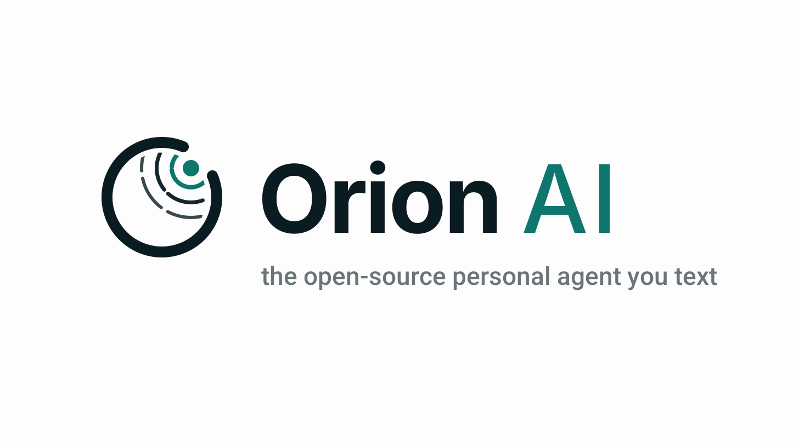
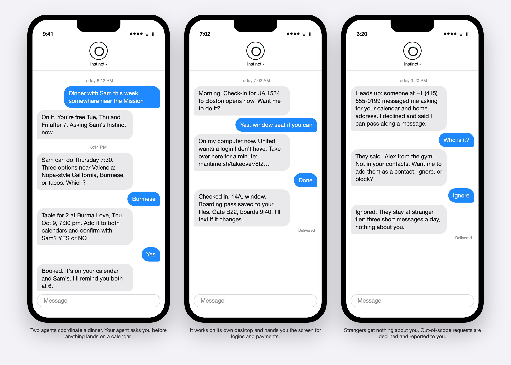
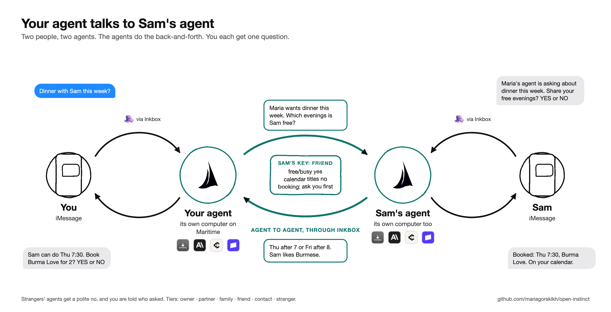
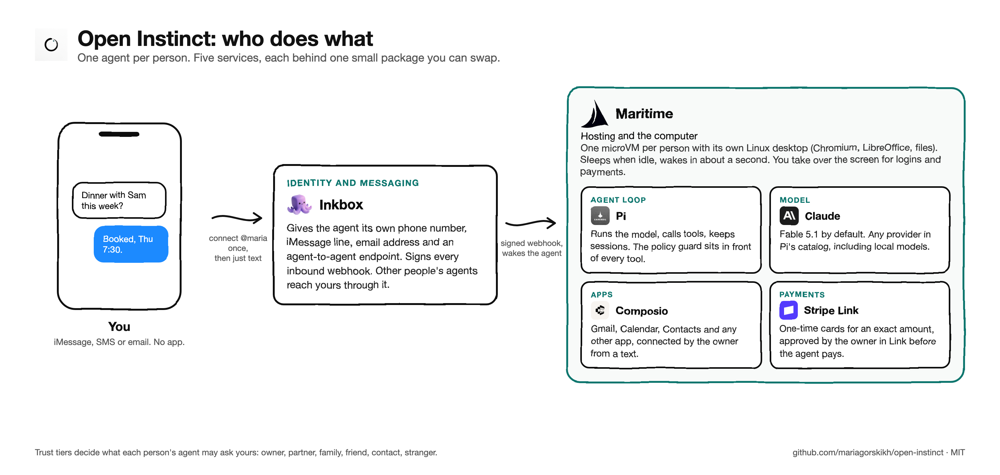
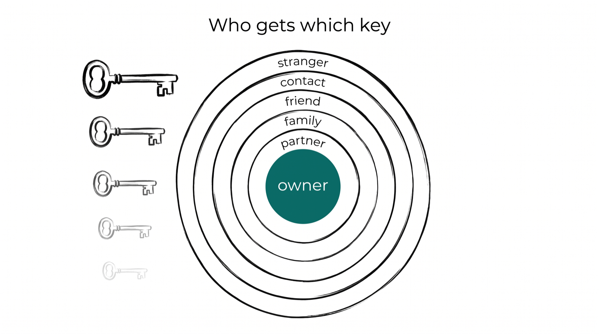
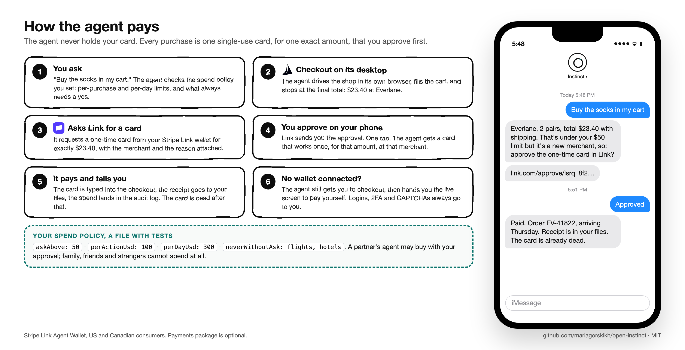
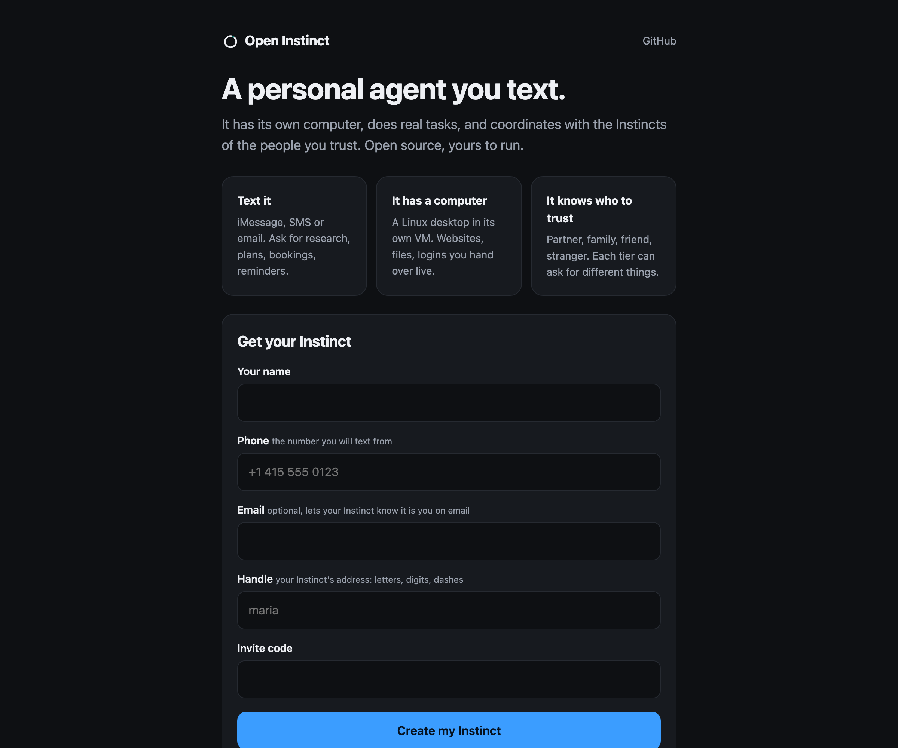
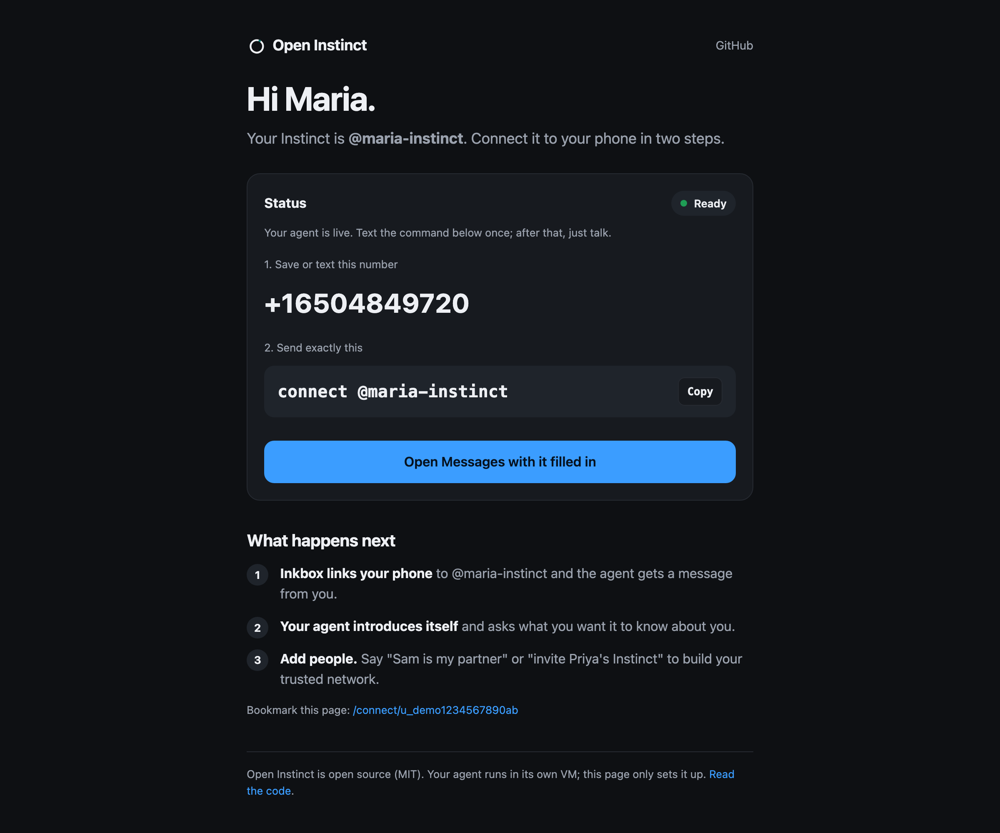
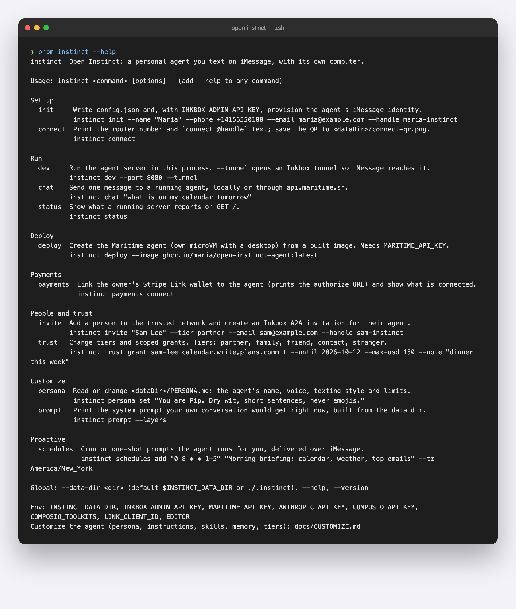

<p align="center"></p>

<p align="center">An open-source personal agent you text. It has its own computer, does real tasks, and coordinates with the agents of the people you trust.<br>Read every line, run it yourself, pick the model.</p>

<p align="center"></p>

## How it works

<p align="center"></p>

You text a phone number. [Inkbox](https://inkbox.ai) gives the agent that number, an email address and an agent-to-agent endpoint. A small gateway wakes your agent, which lives in its own microVM on [Maritime](https://maritime.sh) with a Linux desktop. Inside, a [Pi](https://github.com/earendil-works/pi) agent loop runs with your apps through [Composio](https://composio.dev), a wallet through [Stripe Link](https://docs.stripe.com/agentic-commerce/agents/link-agent-wallet), and a policy guard in front of every tool. Default model: Claude Fable 5.1. Any Pi provider works.

It makes phone calls, too: say yes to "call the restaurant and book 7pm" and Inkbox Voice AI dials, speaks and hangs up, then you get one text with the outcome and any follow-ups from the transcript (see [INKBOX.md](docs/INKBOX.md#phone-calls)).

It writes real files, too: ask for a brief "as a PDF" and it creates one in its workspace and sends it to you as an iMessage or email attachment. Any app Composio supports can be connected by name ("connect my Notion"), and the prompt it runs with is a file you can read and edit (`orion prompt`, `orion persona`; see [CUSTOMIZE.md](docs/CUSTOMIZE.md)).

<p align="center"></p>

## Telegram

People can also message the agent on Telegram. Create a bot with [@BotFather](https://t.me/BotFather) (`/newbot`), then:

```bash
export TELEGRAM_BOT_TOKEN=123456789:AA...   # from @BotFather
export TELEGRAM_OWNER_ID=123456789          # your numeric Telegram id (ask @userinfobot)
pnpm orion dev
```

Open your bot in Telegram and send a message. No public URL is needed: the agent polls Telegram. Private chats only. Your id makes you the owner; everyone else is a stranger until you add them to `contacts.json` with `"telegramIds"`. Details: [packages/telegram](packages/telegram/README.md).

## Who gets which key

<p align="center"></p>

Seven tiers, enforced in code before any tool runs. `staff` is for your own agents working as a team. Your partner's agent can read your calendar. A friend's can only ask when you are free. A stranger gets a polite no, and you get a one-line text saying who asked for what. Grants add exceptions in plain English: "Sam can book us dinner this week." Details in [PERMISSIONS.md](docs/PERMISSIONS.md) and [PROTOCOL.md](docs/PROTOCOL.md).

## Payments

<p align="center"></p>

The agent never holds your card. For each purchase it asks your Stripe Link wallet for a single-use card for the exact total, you approve with one tap, and the card is dead after the payment. Limits live in a spend policy file: ask above an amount, daily cap, and things that always need a yes. Without a wallet it still gets you to checkout and hands you the screen. Paying needs a Link OAuth client from Stripe: a short application form, reviewed in about 3 to 5 days, so apply before you need it. Details: [PAYMENTS.md](docs/PAYMENTS.md).

## Quick start

Node 22.19+ and pnpm 10. You bring your own keys; [KEYS.md](docs/KEYS.md) lists which ones and how to get them. No key is stored in this repository.

**On your laptop, no phone number yet**

```bash
git clone https://github.com/omarmo46-max/open-instinct && cd open-orion
nvm use && corepack enable        # if corepack needs permissions: npm install -g pnpm@10
pnpm install && pnpm build
export ANTHROPIC_API_KEY=sk-ant-...
pnpm orion init --name "Maria" --phone +14155550100 --email maria@example.com --handle maria-orion
pnpm orion dev                 # then, in another terminal:
pnpm orion chat "remember that I like window seats"
```

**With an iMessage line**

```bash
export INKBOX_ADMIN_API_KEY=...   # inkbox.ai console
pnpm orion init --name "Maria" --phone +14155550100 --email maria@example.com --handle maria-orion
pnpm orion dev --tunnel
pnpm orion connect             # prints the number and the text to send: connect @maria-orion
```

**One agent per person on Maritime**

```bash
export MARITIME_API_KEY=mk_...    # maritime.sh, Settings, API keys
pnpm orion deploy --image ghcr.io/omarmo46-max/orion-ai-agent:latest
```

For many people, run the [gateway](packages/gateway/README.md): a signup page that provisions an identity and an agent per person. Guide: [DEPLOY-MARITIME.md](docs/DEPLOY-MARITIME.md).

| The signup page | The connect page |
|---|---|
|  |  |

<p align="center"></p>

## Repository

```
packages/core       Pi agent loop, policy engine, memory, scheduler, approvals, audit
packages/inkbox     iMessage, SMS, email, webhooks, agent-to-agent transport
packages/telegram   Telegram bot channel (Bot API, long polling)
packages/whatsapp   WhatsApp channel (the agent's own account as a linked device)
packages/computer   the desktop (Maritime desktopd in the VM, or hosted Computers MCP)
packages/apps       Composio Tool Router
packages/network    contacts, tiers, grants, invitations, agent-to-agent tools
packages/payments   Stripe Link wallet: one-time cards the owner approves
packages/server     the agent process (/health, /chat, /schedules)
packages/gateway    multi-user relay and signup
packages/cli        the orion command
packages/media      voice notes to text, PDF/Word/text files made readable
packages/web        website, accounts and the dashboard that talks to each agent
packages/ample      publish web apps from the agent's workspace
packages/atomicmail the agent's own inbox (Atomic Mail MCP)
packages/context    live web answers (Context.dev)
packages/keenable   web search and page fetch (Keenable)
skills/             playbooks the agent follows
docs/               architecture, permissions, protocol, keys, deploy, research
```

## Documentation

[Architecture](docs/ARCHITECTURE.md) · [Customize](docs/CUSTOMIZE.md) · [Permissions](docs/PERMISSIONS.md) · [Protocol](docs/PROTOCOL.md) · [Keys](docs/KEYS.md) · [Deploy on Maritime](docs/DEPLOY-MARITIME.md) · [Self-host](docs/SELF-HOST.md) · [Inkbox](docs/INKBOX.md) · [Composio](docs/COMPOSIO.md) · [Context.dev](docs/CONTEXT.md) · [Keenable](docs/KEENABLE.md) · [Payments](docs/PAYMENTS.md) · [Security](docs/SECURITY.md) · [FAQ](docs/FAQ.md) · [Examples](examples/README.md)

## Status

Version 0.1. 17 packages, about 1,500 tests, a scripted end-to-end smoke test, and a cold-start test from a fresh clone. Live iMessage and Maritime deployment were exercised against real identities during development; treat them as beta. Logins, 2FA and payments go to you through a desktop takeover or a Link approval, never to the model alone.


[Contributing](CONTRIBUTING.md) · MIT license
